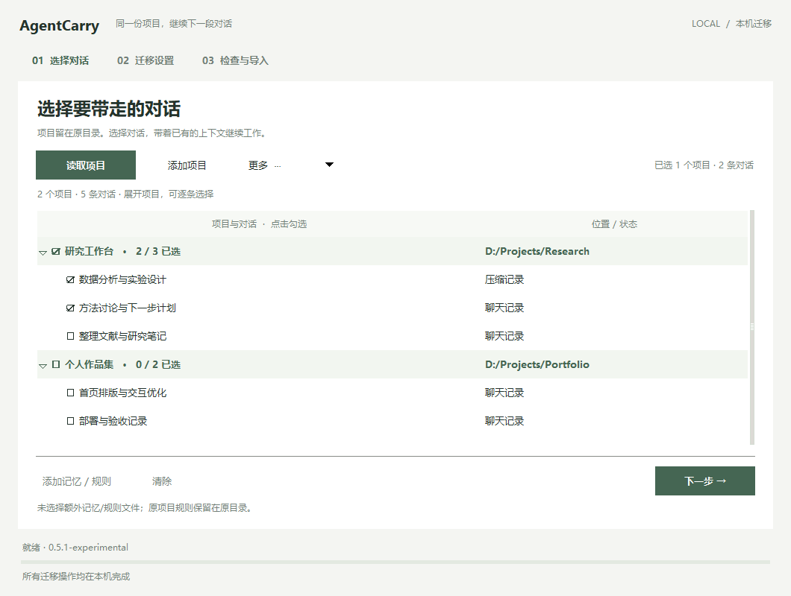

<div align="center">

<h1>AgentCarry</h1>
<p><strong>带上对话，换个 AI 接着干。</strong></p>
<p>Carry your context. Continue your work.</p>

<p>
<a href="https://github.com/IMLfsv/AgentCarry/releases/download/v0.5.1-experimental/AgentCarry-0.5.1-experimental-windows-x64.zip"><strong>下载 Windows 版</strong></a>
&nbsp; · &nbsp;
<a href="https://github.com/IMLfsv/AgentCarry/releases">版本记录</a>
&nbsp; · &nbsp;
<a href="https://github.com/IMLfsv/AgentCarry/issues">反馈问题</a>
</p>

</div>

把 Codex 的历史对话带到 Antigravity，在同一份项目上继续工作。

项目代码、文档和数据留在原目录。选择想带走的会话，检查迁移报告，就能在新的工作台接着聊。

**当前支持：Windows x64 · Codex → Antigravity 2.32.2 · 同机迁移**



## 为什么用 AgentCarry

- **接着聊**：将所选历史文字消息迁入 Antigravity 原生会话。
- **继续用原项目**：直接关联原目录，代码、文档、数据和 Git 仓库留在原处。
- **按需选择**：展开项目，逐条勾选会话；支持普通记录和压缩记录。
- **看得见进度**：三步向导展示当前阶段、完成数量和用时。
- **保留退路**：导入前生成报告和备份，提供重复导入识别与恢复入口。
- **本机完成**：迁移过程在本地执行，无需上传聊天和项目文件。

## 开始使用

1. **下载并解压**：下载 Windows ZIP，完整解压后运行 `AgentCarry.exe`，无需安装 Python。
2. **选择对话**：点击“读取项目”，展开项目并勾选需要迁移的会话。
3. **设置位置**：点击“下一步”，选择迁移方式和资料保存目录。
4. **检查并导入**：保存 Antigravity 中的工作，通过“检查与导入”页退出客户端及后台进程；准备报告，确认原项目目录和转换差异后执行导入。
5. **继续工作**：打开 Antigravity，在迁入的项目和会话中继续。

如报告列出了转换差异，阅读后勾选“接受报告列出的转换差异”，再重新准备并执行导入。

“更多”菜单提供全选、归档与内部任务筛选、更改 Codex 数据目录等操作。客户端路径和数据库维护位于“高级路径与维护”。

## 哪些内容会迁移

| 内容 | 处理方式 |
|---|---|
| 项目代码、文档、数据、Git 仓库 | 直接关联原目录，不复制整份项目 |
| Codex 聊天记录 | 转换为目标客户端的原生文字会话，同时保留历史档案；源文件不改动 |
| 工具调用、非文字事件 | 保留在历史档案中，不重建为目标客户端的执行记录 |
| 历史附件 | 保留本机文件引用，不重建原生媒体记录 |
| 原项目规则与记忆 | 留在原处，是否加载由目标客户端的规则机制决定 |
| 额外选择的规则与记忆 | 单独存档，不自动写入或激活到原项目 |
| 报告、备份与恢复记录 | 保存到所选迁移资料目录 |

迁移资料目录应放在原项目之外。其中 `archives` 保存历史档案，`runs` 保存迁移任务、报告、备份和恢复记录。

## 使用说明

- 当前仅支持同一台 Windows 电脑上的迁移。原生写入支持 Antigravity 2.32.2 的兼容安装版本；程序会检查版本与存储格式。
- 目标客户端可能使用首条消息显示会话名称；原标题保留在档案中，原生消息时间会重新生成。
- 相同聊天可识别重复导入；普通代码修改不影响识别。新增会话或聊天内容变化的增量合并暂不支持。
- 原项目目录必须存在。准备后若目录被替换或改为链接，需要重新检查。
- 原生适配基于客户端本地存储格式，客户端更新可能影响兼容性。

<details>
<summary>从 0.4.x 升级</summary>

旧版复制模式的迁移包需要重新准备。已导入的项目不会自动从复制目录改绑到原目录，也不会自动合并。

如需重新迁移，可在确认目标数据没有后续修改时，使用原计划恢复旧导入，再重新读取本机项目。

</details>

## 从源码运行

```powershell
python -m pip install -r requirements.txt
python app.py
```

开发与构建入口见仓库中的 `tests/`、`build_release.py` 和 GitHub Actions 工作流。

[MIT License](LICENSE)。依赖许可证随下载包提供。
